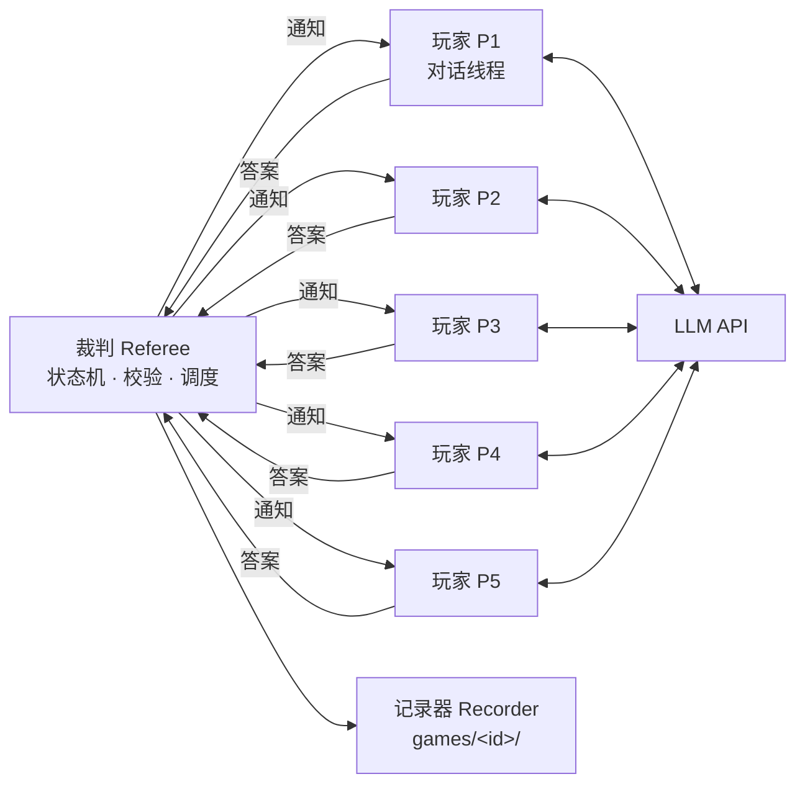
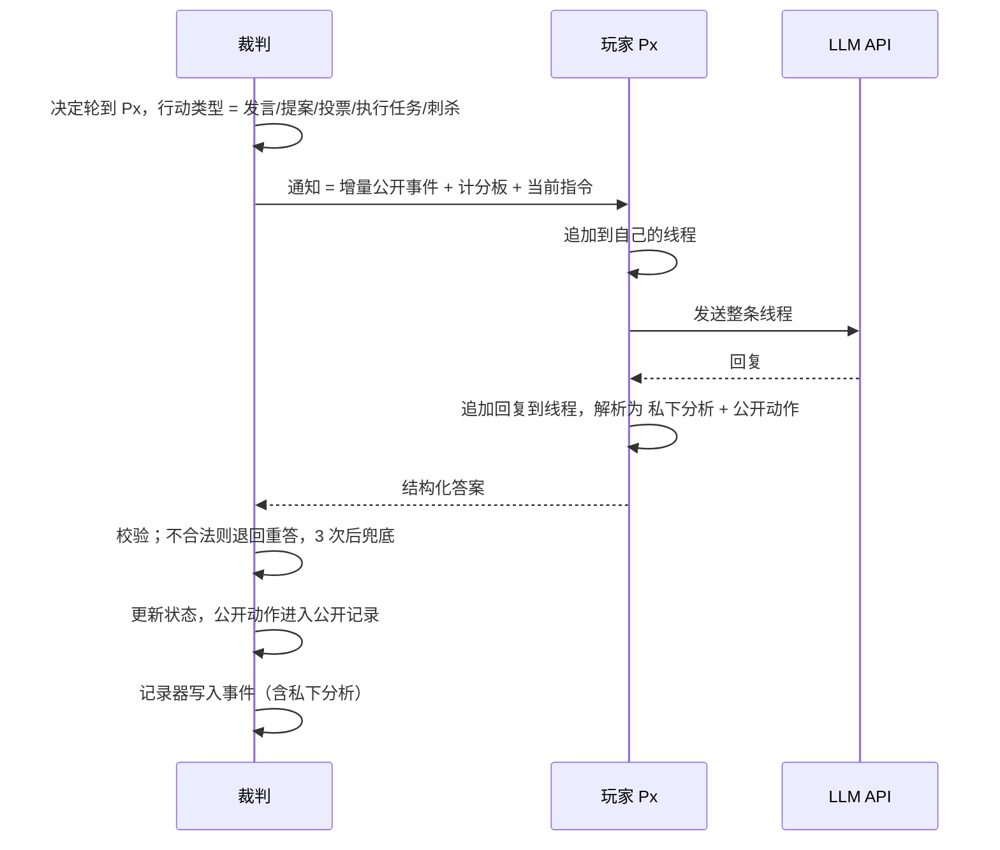
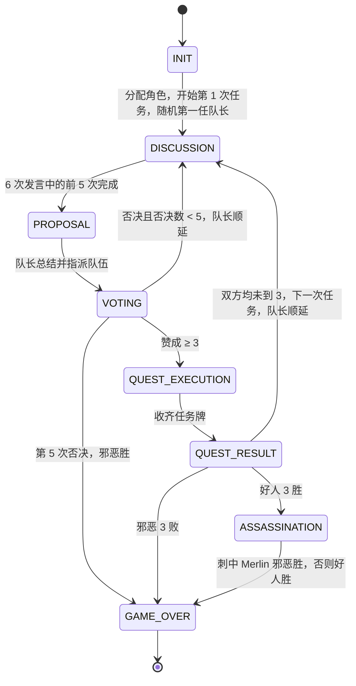

# 系统架构（v1）

> 起草日期：2026-09-13

本文描述系统"现在是什么样"：组成部分、信息流、模块职责、落盘内容。规则本身见 [rules.md](rules.md)，"为什么这样设计"见 [decisions/](decisions/)。

## 一、总览

系统由三部分组成：

- **裁判**：非 AI 的确定性状态机。持有全部游戏状态，推进阶段，决定轮到谁、该做什么，向玩家发通知、收答案、校验合法性，并把公开部分广播给其他玩家。所有"工具调用"级别的决定都由裁判做出，玩家不主动调用任何东西。
- **玩家**：5 个 chatbot。每个玩家是一条独立的、持续整局的对话线程，通过 API 调用大模型。玩家只做一件事：收到裁判通知，回一段结构化文本。v1 五个座位统一使用 DeepSeek V4.1 Flash。
- **记录器**：把一局中发生的一切落盘，供复盘与统计。
- **网页服务（裁判席）**：管理员用浏览器新开、监控、暂停、终止对局，多局并行；从记录器的事件流实时推送，也能回放任一时刻。见第十节。



玩家之间没有任何直接通路。一名玩家说的话，只有经过裁判判定为"公开动作"后，才会出现在其他玩家的下一次通知里。

## 二、一次行动的信息流

裁判每次只和一名玩家交互，一问一答，称为一次行动（`turn`）。



### 通知的内容

每次通知由三部分组成，全部由裁判生成：

1. **增量公开事件**：自该玩家上一次行动以来发生的所有公开事件，按时间排列。包括他人的发言、队长变更、队伍指派、投票结果、任务结果。玩家的线程里已经有更早的内容，不重复发送。
2. **计分板**：当前是第几次任务、第几次提案、否决计数、队长、比分，以及历次任务的队伍、每人投票和结果的精简表。这部分每次都发，让关键事实不必从长上下文里翻找。
3. **当前指令**：现在要做什么、可选项是什么、输出格式是什么。

### 答案的格式

玩家的回复固定分为两段，用标记分隔，裁判按标记解析：

```
【私下分析】
（自由文本。玩家的推理、怀疑、计划。只留在自己的线程里，任何其他玩家都看不到。）

【公开发言】            ← 发言、提案时
（对全桌说的话。）

【队伍】P2, P4          ← 提案时
【投票】赞成            ← 投票时，赞成 / 反对
【任务】成功            ← 邪恶玩家执行任务时，成功 / 失败
【刺杀】P3              ← 刺杀时
```

裁判只把"公开发言"及后面的动作字段广播出去，"私下分析"绝不进入任何其他玩家的上下文。

私下分析必须以可见文本输出，不能依赖模型的隐藏推理模式：隐藏推理内容不会被带回下一次请求，等于每轮都忘。以可见文本输出的私下分析累积在线程中，就是玩家的跨轮记忆。这是 [decisions/0003](decisions/0003-single-thread-memory.md) 的核心。

## 三、玩家线程模型

每个玩家持有一份 `messages` 列表，整局只增不删：

```
[system]    规则摘要、你的座位、角色、隐藏信息、阵营目标、输出格式、发言风格要求。规则部分人人相同；输出格式部分只列该角色可能被要求输出的标记，例如只有邪恶有任务牌一项、只有刺客有刺杀一项
[user]      裁判通知 1
[assistant] 玩家回复 1（私下分析 + 公开动作）
[user]      裁判通知 2
[assistant] 玩家回复 2
...
```

- 不清空，不总结。实测关闭隐藏思考的对局，单条线程在局末约 1.4 万到 2 万 token，远小于模型窗口；一局全部调用累计输入 25 万到 60 万 token，其中八成以上命中前缀缓存。
- 不维护独立的"记忆文件"或"信任值"。玩家对他人的判断以自由文本写在私下分析里。
- 不合法答案的退回也作为一条 `[user]` 消息追加，只含原因与本次指令，不重发公开事件；玩家的重答作为 `[assistant]` 追加，保持线程完整。
- 每名玩家收到的公开事件是公开记录的一个前缀：裁判为每人维护一个"已看到多少条"的游标，每次通知只发游标之后的部分。玩家自己的发言不再重发，因为它已经以回复的形式在线程里；例外是兜底发言，那不是玩家写的，照常发给他。投票结果、队伍指派等集体事件照常发。
- 唯一的删除：管理员掐断一次进行中的调用时，这份通知从线程末尾撤回，如同从未发出；继续后原样重发。模型看不到任何痕迹，裁判日志里记一条作废调用。见第十节与 [decisions/0009](decisions/0009-two-step-pause-and-web-service.md)。
- 每条线程在每次行动后落盘。v1 不实现从落盘状态恢复中断的一局，落盘只为复盘与日后恢复功能预留。
- 游戏结束的公告只进公开记录与落盘文件，不再向玩家发通知，避免一次无用的 API 调用。

## 四、状态机



各阶段中裁判要做的事：

| 阶段 | 裁判动作 | 与谁交互 |
|---|---|---|
| INIT | 随机分配角色，生成每人的隐藏信息，写 system prompt，随机一局的第一任队长 | 无 |
| DISCUSSION | 依次向队长、队长下一位……共 5 人发"发言"通知 | 5 人依次 |
| PROPOSAL | 向队长发"总结并指派"通知，校验队伍 | 队长 |
| VOTING | 向 5 人发"投票"通知，收齐后公布每人的票 | 5 人。逻辑上同时；默认并发请求，`--sequential` 改为依次。玩家看不到彼此的票 |
| QUEST_EXECUTION | 好人自动成功，向队伍中的邪恶玩家发"执行任务"通知 | 队伍中的邪恶玩家，与投票同样可并发 |
| QUEST_RESULT | 统计失败牌，公布成败与张数，更新比分，判断下一步 | 无 |
| ASSASSINATION | 向 Assassin 发"刺杀"通知 | Assassin |
| GAME_OVER | 判定胜方，公布全部角色，写结果文件 | 无 |

## 五、模块职责

```
avalon/
├── config.py      运行配置：模型、座位到模型的映射、随机种子、重试次数、输出目录、并发与隐藏思考开关、价目表与费用估算。从 .env 与命令行读取
├── rules.py       纯规则，无状态、无副作用：角色与阵营、任务人数表、隐藏信息生成、投票是否通过、任务是否失败、胜负判定
├── state.py       游戏状态的数据结构：阶段、任务与提案历史、每人投票、比分、当前队长。只有数据，没有流程
├── referee.py     状态机主循环：推进阶段、决定轮到谁、组装通知、校验答案、兜底、把公开动作写入公开记录；每次发通知前经过控制器的检查点
├── control.py     运行控制：两段式暂停与终止的状态与信号，不含游戏逻辑，不写日志
├── player.py      Player 接口，以及两种实现：LLMPlayer 维护线程并调用 llm，被掐断时撤回通知；RandomPlayer 随机给合法答案，可模拟思考延迟，供测试与不联网演示；装配五个座位的函数也在这里
├── llm.py         对 DeepSeek 的 OpenAI 兼容接口的封装：超时、两层重试、隐藏思考开关、取回 usage 与隐藏推理、按信号掐断进行中的请求。不含任何游戏逻辑
├── prompts.py     所有面向模型的文本：system prompt 模板、各行动的指令模板、计分板渲染、答案的解析
├── recorder.py    落盘：事件流、每个玩家的线程、公开状态、结果、人可读的复盘稿；每条事件写入后可转交订阅者
├── web/
│   ├── manager.py 多局管理：新开、排队、每局一个线程、暂停、终止、对局列表与跨局统计、事件订阅
│   ├── server.py  HTTP 接口与 SSE 事件流（FastAPI）；入口页动态生成，给前端文件地址加版本号
│   └── static/    裁判席页面：纯静态文件，无框架无打包
└── __main__.py    命令行入口：在终端跑一局，或 `serve` 启动网页服务
```

依赖方向：`referee` 依赖 `rules`、`state`、`player`、`prompts`、`recorder`、`control`；`player` 依赖 `llm`、`prompts`、`config`、`control`；`web` 依赖以上全部，反向没有任何依赖；`rules` 和 `state` 不依赖任何其他模块。`prompts` 是唯一会被频繁修改的模块，其他模块不含任何面向模型的文字。

### 不合法答案的处理

校验分两层：格式层在玩家内部，模型输出无法按标记解析时玩家抛出"答案不合法"异常；内容层在裁判，例如队伍人数不对、刺杀目标是自己。两层的原因文字都来自 `prompts.py`，由裁判原样退回给玩家。同一次行动内连续 3 次不合法即兜底，兜底值见 rules.md 第十一节；每次不合法与每次兜底都写入事件流，`result.json` 汇总次数。

### 进度输出

裁判通过两个回调把公开事件与每名玩家的私下分析交给命令行入口打印，`--quiet` 只打印公开事件。裁判本身不做任何打印。

`Player` 是裁判与外界之间唯一的接缝。裁判只认一个接口："给一份通知，收回一个答案"。日后接入别的模型、别的提供商，或者让人类坐进一个座位，都只是再写一个 `Player` 实现。

## 六、落盘

每局在 `games/` 下生成一个自包含目录，目录名为时间戳加短随机串，例如 `games/20260913-2145-a3f2/`。

| 文件 | 内容 | 给谁看 |
|---|---|---|
| `public.json` | 公开状态：座位、历次任务的队伍与投票与结果、比分、胜方，以及完整的公开发言记录 | 程序、人 |
| `events.jsonl` | 裁判视角的全部事件，一行一条，含角色分配、每张任务牌出自谁、每次行动的私下分析、非法答案与兜底、每次 API 调用的耗时、结束原因、完整 usage（输入、输出、推理、缓存命中与未命中的 token 数）、按价目表估算的费用，以及开启隐藏思考时接口返回的推理原文。事件种类见下表 | 程序 |
| `players/P1.json` … `P5.json` | 每个玩家完整的 `messages` 线程，即该玩家在局中每一刻确切看到和说过的一切 | 程序、人 |
| `result.json` | 状态（正常结束、已终止、出错）、全部角色、胜方、胜利方式、刺杀目标、用时（不含暂停）、暂停时长、调用次数、各类 token 合计、估算费用、不合法、兜底与作废调用次数 | 程序 |
| `transcript.md` | 按时间排版的复盘稿：每条公开发言、每次投票、每次任务结果，以及每名玩家当时的私下分析，私下分析以明显标记区分 | 人 |

事件种类（`kind` 字段）：

| 种类 | 何时写 | 要点 |
|---|---|---|
| `game_start` | 开局 | 种子、各座位模型、隐藏思考开关、角色分配 |
| `quest_start`、`leader` | 每次任务、每次提案开始 | 队长是否顺延 |
| `ask` | 裁判向一名玩家发出通知前 | 行动、第几次尝试。界面据此显示谁在生成、已等多久 |
| `llm_call` | 一次模型调用返回后 | 耗时、各类 token、费用、usage 原样、隐藏推理原文 |
| `turn` | 一次合法答案 | 私下分析与公开动作 |
| `invalid_reply`、`fallback` | 不合法答案、连续不合法后兜底 | 原因、兜底值 |
| `team`、`votes`、`quest_result`、`assassination`、`game_over` | 公开进程 | 与 public.json 对应，`quest_result` 另含每张牌出自谁 |
| `voided_call` | 管理员掐断一次进行中的调用 | 已等待秒数。该通知从玩家线程撤回，继续后重发 |
| `pause_requested`、`pause_forced`、`paused`、`resumed`、`terminate_requested`、`terminated`、`error` | 管理员操作与异常 | 暂停时长按 `paused` 到 `resumed` 计算 |

目录里有 `events.jsonl` 但没有 `result.json` 的局，是服务进程在它打完前退出留下的，列表里显示为"已中断"。

`games/` 整体被 gitignore。

## 七、配置

| 项 | 来源 | 说明 |
|---|---|---|
| `DEEPSEEK_API_KEY` | `.env` | 必填 |
| `DEEPSEEK_BASE_URL` | `.env` | 可选，默认 `https://api.deepseek.com` |
| `DEEPSEEK_MODEL` | `.env` | 可选，默认 `deepseek-flash`，即接口上 V4.1 Flash 的 ID |
| `DEEPSEEK_THINKING` | `.env` | 可选，默认开。`off` 关闭模型的隐藏思考，一局快数倍、便宜十倍以上，见 [decisions/0010](decisions/0010-hidden-thinking-on-by-default.md)。网页里每局可单独选 |
| 座位到模型映射 | `config.py` | v1 五个座位相同，结构上允许各不相同 |
| 随机种子 | 命令行 | 控制角色分配与队长随机。模型输出本身不可复现 |
| 重试次数 | `config.py` | 同一次行动内连续 3 次不合法即兜底；API 网络错误与 429/5xx 由 SDK 另行重试 3 次 |
| 并发 | 命令行 | 默认并发请求投票与执行任务，`--sequential` 关闭 |
| 价目表 | `config.py` | 每个模型的缓存命中输入、未命中输入、输出三项单价，取 DeepSeek 空闲时段价；费用估算只是参考，高峰时段约为两倍 |
| 网页服务 | 命令行 `serve` | `--host` 默认只监听本机，`--port` 默认 8000，`--max-games` 同时进行的对局上限默认 8，`--games-dir` 产物目录。网页里新开一局时可逐局指定种子、模型、隐藏思考、随机玩家、局数，API key 仍只从 `.env` 读 |

## 八、测试策略

- `tests/test_rules.py`：规则函数的单元测试。任务人数、投票判定、失败判定、胜负判定、每个角色在全部 120 种分配下的隐藏信息。
- `tests/test_referee.py`：用假玩家跑完整局，不联网、不花钱、给定种子可复现。随机玩家 40 个种子验证状态机不变量；脚本玩家分别逼出否决 5 次、邪恶三败、刺中与未刺中四条终局路径；故意出错的玩家验证退回重答与兜底；另验证私下分析不出现在任何其他玩家的通知与 public.json 中，只出现在裁判日志与复盘稿中。这是本项目最重要的测试。
- `tests/test_prompts.py`：答案解析的用例，包括格式不全、多余内容、非法值、markdown 加粗包裹、同一标记重复出现。
- `tests/test_player.py`：用假客户端验证 LLM 玩家的线程只增不删、不合法输出也进线程、退回重答的消息只含原因。
- `tests/test_control.py`：两段式暂停与终止。控制器本身的状态转移；带闸门的慢玩家逼出"软暂停等调用返回、掐断作废并原样重发、终止立刻退出、并行投票中暂停"四种情形；掐断后玩家线程回滚；对着一个永不回话的本机假接口验证掐断不必等它。
- `tests/test_web.py`：多局管理器与 HTTP 接口。并发上限与排队、两段式暂停与终止的落盘结果、暂停时长扣除、磁盘上已中断对局的识别、缺 API key 时的报错；事件流走真实本机端口，验证推送顺序、带序号续传、断线后清理订阅。

全部测试不联网。真实模型只在 `uv run avalon` 与网页里用非随机玩家开局时接入。

## 九、运行

```bash
uv sync
cp .env.example .env   # 填入 DEEPSEEK_API_KEY
uv run avalon --seed 42
```

命令行参数：`--seed` 随机种子，缺省随机生成并打印；`--games-dir` 产物目录，默认 `games/`；`--random-players` 用随机玩家跑一局，不联网，用于自检；`--sequential` 关闭并发；`--quiet` 终端不打印私下分析。

运行中终端实时打印公开事件与每名玩家的私下分析，结束时打印用时与估算费用。一局结束后在 `games/<id>/transcript.md` 复盘。

网页裁判席：

```bash
uv run avalon serve            # 打开 http://127.0.0.1:8000/
```

浏览器里新开一局、看进度、暂停、终止、回放、看复盘稿与每名玩家的完整线程；`games/` 里已有的对局也都在列表里。细节见第十节。

## 十、网页服务（裁判席）

界面设计见 [admin-console-design.md](admin-console-design.md)，决策见 [decisions/0009](decisions/0009-two-step-pause-and-web-service.md)。

**多局并行。** 服务进程里每局一个线程跑裁判主循环，同时最多 `--max-games` 局，多出的排队，前面的结束后自动开始。对局列表合并两处来源：本进程里的对局与 `games/` 目录里已落盘的对局；同一局两处都有时以本进程为准。状态取值：排队中、进行中、暂停中、已暂停、终止中、已结束、已终止、出错、已中断。

**两段式暂停与终止。** 裁判每次向玩家发通知前经过控制器的检查点，进行中的模型调用在控制器登记。

- 暂停第一下：软暂停。检查点关闭，进行中的调用跑完并正常记录，然后进入"已暂停"。
- 暂停中再按一下：掐断。进行中的调用立刻作废：模型客户端断开连接并丢弃结果，玩家把这份通知从线程末尾撤回，裁判记一条作废调用，回到检查点等待。继续后原样重发同一份通知。
- 继续：打开检查点。
- 终止：掐断进行中的调用，让等在检查点的裁判线程抛出中止异常；然后把公开状态、结果（状态为已终止）、五条线程、复盘稿全部写完，目录与正常结束的一局一样完整。
- 模型调用连续失败等异常同样被捕获并落盘，状态为出错。
- 用时不含暂停：只扣"没有任何调用在跑、纯等待"的时间；软暂停等调用返回的那段仍算用时。

**实时推送。** 记录器每写一条事件就交给该局的订阅者；浏览器通过 SSE 接收，一局一条流，每条消息带事件序号，断线后自动带上最后一条序号续传。状态变化（暂停、继续、结束等）作为单独的消息推送。对局列表页另有一条全局流，推送每局摘要的变化。

**回放。** 浏览器一次拿到整局事件列表，按序号截断后重新归约出画面，因此进行中与已结束的局是同一套代码；模型不会被重新调用。界面上的一切都从 `events.jsonl` 推出，不读 `public.json`。回放的步进、进度条与顶栏的事件计数有两档粒度：简略（默认）把一次行动的提问、模型返回、答案合成一步，五路并行的投票合成一步，任务开始与队长指定合成一步，连续的暂停类操作合成一步；详细一条原始事件一步。落盘的事件不变，两档只是浏览器里的分组。进度条可拖动、可点击，旁边的输入框可以直接跳到第几步。

**设置页。** 只存在浏览器本地，不进服务端：事件粒度、私下分析块的默认展开方式、自动回放速度、线程页是否默认显示隐藏推理。

**渲染方式。** 页面每次都整体重新生成 HTML，但不是替换 DOM，而是按位置合并进现有节点：正在拖的滑条、正在输入的框、正在点的按钮仍是原来那个节点，事件流每秒推几条更新也不会打断操作。切走的画面会被标记为已废弃，它残留的延迟回调不再往页面上画。

**缓存与更新。** 前端文件本身是静态的，但入口页由服务端动态生成：脚本与样式地址带上前端文件的最新修改时间作版本号，模块之间的相对引用经 import map 同样改走带版本号的地址；入口页与静态文件都带 `Cache-Control: no-cache`。文件一变地址就变，浏览器只能重新下载，所以改前端后普通刷新即可生效，不必清缓存、不必重启服务。页面每次切换画面时还会对比服务端的版本号，不一致就自动整页刷新。改 Python 代码则要重启服务进程。

**接口一览。**

| 方法与路径 | 用途 |
|---|---|
| `GET /api/config` | 新开一局表单的默认值、是否配了 API key、并发上限、前端文件版本号 |
| `GET /api/games`、`POST /api/games` | 对局列表与跨局统计；新开若干局 |
| `GET /api/games/{id}`、`GET /api/games/{id}/events?since=N` | 一局摘要；事件列表 |
| `GET /api/games/{id}/stream`、`GET /api/stream` | 该局的事件流；全部对局的摘要变化 |
| `POST /api/games/{id}/pause`、`resume`、`terminate` | 暂停（两段式）、继续、终止 |
| `GET /api/games/{id}/players/{pid}` | 一名玩家的完整消息线程 |
| `GET /api/games/{id}/files/{name}` | 下载或在线读取产物文件，只允许目录内的固定几个文件名 |

**安全边界。** 服务默认只监听本机，没有登录；裁判席看的是上帝视角，`--host 0.0.0.0` 开放到局域网前要清楚这一点。API key 不经过任何接口。
