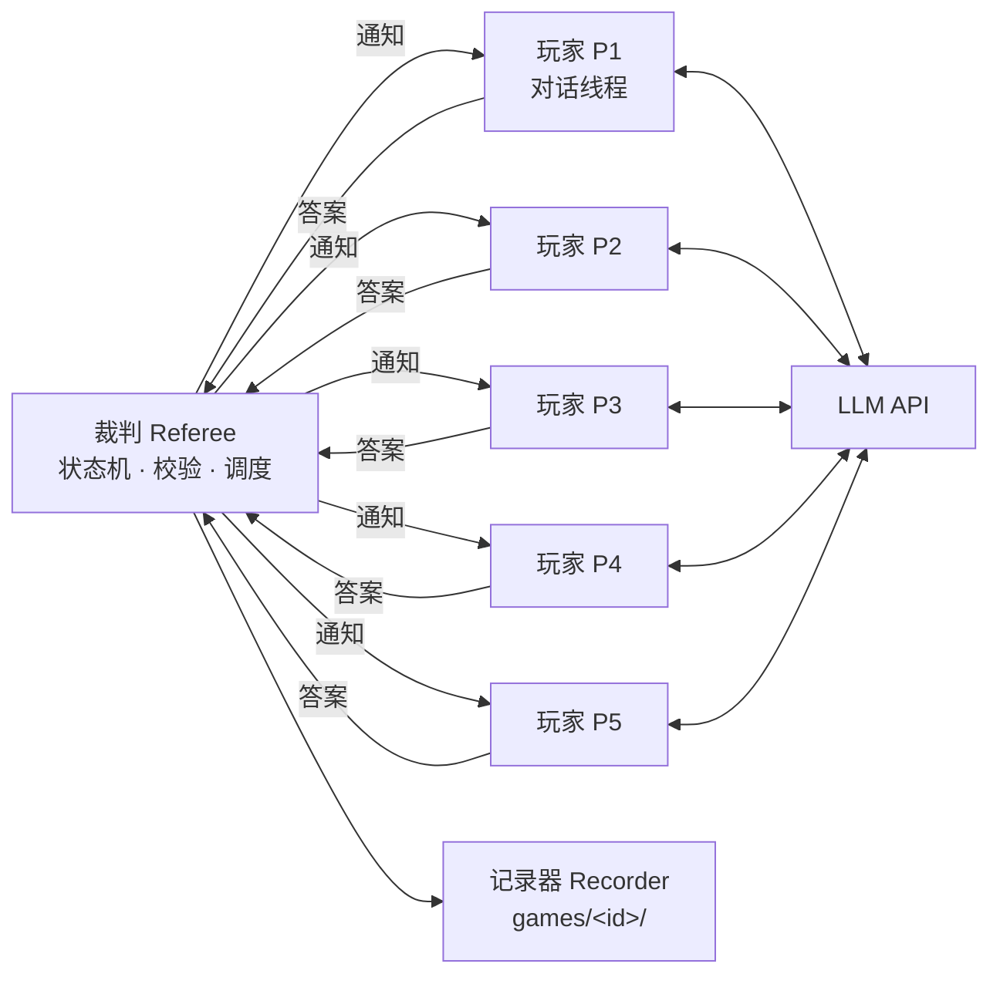
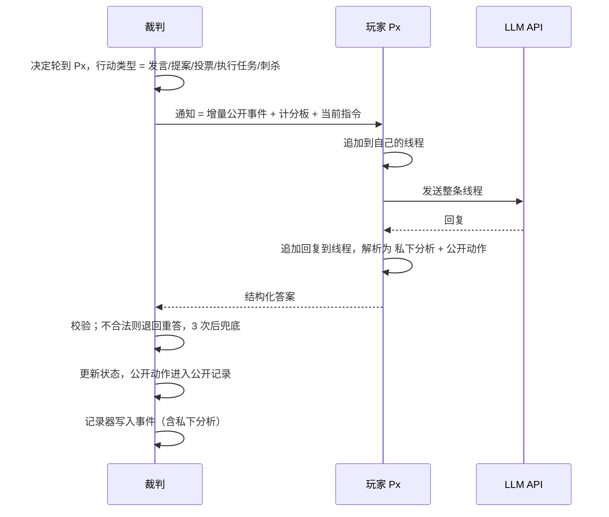
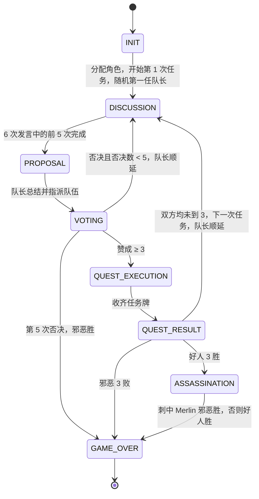

# 系统架构（v1）

> 起草日期：2026-09-13

本文描述系统"现在是什么样"：组成部分、信息流、模块职责、落盘内容。规则本身见 [rules.md](rules.md)，"为什么这样设计"见 [decisions/](decisions/)。

## 一、总览

系统由三部分组成：

- **裁判**：非 AI 的确定性状态机。持有全部游戏状态，推进阶段，决定轮到谁、该做什么，向玩家发通知、收答案、校验合法性，并把公开部分广播给其他玩家。所有"工具调用"级别的决定都由裁判做出，玩家不主动调用任何东西。
- **玩家**：5 个 chatbot。每个玩家是一条独立的、持续整局的对话线程，通过 API 调用大模型。玩家只做一件事：收到裁判通知，回一段结构化文本。v1 五个座位统一使用 DeepSeek V4.1 Flash。
- **记录器**：把一局中发生的一切落盘，供复盘与统计。



玩家之间没有任何直接通路。一名玩家说的话，只有经过裁判判定为"公开动作"后，才会出现在其他玩家的下一次通知里。

## 二、一次行动的信息流

裁判每次只和一名玩家交互，一问一答，称为一次行动（`turn`）。



### 通知的内容

每次通知由三部分组成，全部由裁判生成：

1. **增量公开事件**：自该玩家上一次行动以来发生的所有公开事件，按时间排列。包括他人的发言、队长变更、队伍指派、投票结果、任务结果。玩家的线程里已经有更早的内容，不重复发送。
2. **计分板**：当前是第几次任务、第几次提案、否决计数、队长、比分，以及历次任务的队伍、每人投票和结果的精简表。这部分每次都发，让关键事实不必从长上下文里翻找。
3. **当前指令**：现在要做什么、可选项是什么、输出格式是什么。

### 答案的格式

玩家的回复固定分为两段，用标记分隔，裁判按标记解析：

```
【私下分析】
（自由文本。玩家的推理、怀疑、计划。只留在自己的线程里，任何其他玩家都看不到。）

【公开发言】            ← 发言、提案时
（对全桌说的话。）

【队伍】P2, P4          ← 提案时
【投票】赞成            ← 投票时，赞成 / 反对
【任务】成功            ← 邪恶玩家执行任务时，成功 / 失败
【刺杀】P3              ← 刺杀时
```

裁判只把"公开发言"及后面的动作字段广播出去，"私下分析"绝不进入任何其他玩家的上下文。

私下分析必须以可见文本输出，不能依赖模型的隐藏推理模式：隐藏推理内容不会被带回下一次请求，等于每轮都忘。以可见文本输出的私下分析累积在线程中，就是玩家的跨轮记忆。这是 [decisions/0003](decisions/0003-single-thread-memory.md) 的核心。

## 三、玩家线程模型

每个玩家持有一份 `messages` 列表，整局只增不删：

```
[system]    规则摘要、你的座位、角色、隐藏信息、阵营目标、输出格式、发言风格要求。规则部分人人相同；输出格式部分只列该角色可能被要求输出的标记，例如只有邪恶有任务牌一项、只有刺客有刺杀一项
[user]      裁判通知 1
[assistant] 玩家回复 1（私下分析 + 公开动作）
[user]      裁判通知 2
[assistant] 玩家回复 2
...
```

- 不清空，不总结。实测关闭隐藏思考的对局，单条线程在局末约 1.4 万到 2 万 token，远小于模型窗口；一局全部调用累计输入 25 万到 60 万 token，其中八成以上命中前缀缓存。
- 不维护独立的"记忆文件"或"信任值"。玩家对他人的判断以自由文本写在私下分析里。
- 不合法答案的退回也作为一条 `[user]` 消息追加，只含原因与本次指令，不重发公开事件；玩家的重答作为 `[assistant]` 追加，保持线程完整。
- 每名玩家收到的公开事件是公开记录的一个前缀：裁判为每人维护一个"已看到多少条"的游标，每次通知只发游标之后的部分。玩家自己的发言不再重发，因为它已经以回复的形式在线程里；例外是兜底发言，那不是玩家写的，照常发给他。投票结果、队伍指派等集体事件照常发。
- 每条线程在每次行动后落盘。v1 不实现从落盘状态恢复中断的一局，落盘只为复盘与日后恢复功能预留。
- 游戏结束的公告只进公开记录与落盘文件，不再向玩家发通知，避免一次无用的 API 调用。

## 四、状态机



各阶段中裁判要做的事：

| 阶段 | 裁判动作 | 与谁交互 |
|---|---|---|
| INIT | 随机分配角色，生成每人的隐藏信息，写 system prompt，随机一局的第一任队长 | 无 |
| DISCUSSION | 依次向队长、队长下一位……共 5 人发"发言"通知 | 5 人依次 |
| PROPOSAL | 向队长发"总结并指派"通知，校验队伍 | 队长 |
| VOTING | 向 5 人发"投票"通知，收齐后公布每人的票 | 5 人。逻辑上同时；默认并发请求，`--sequential` 改为依次。玩家看不到彼此的票 |
| QUEST_EXECUTION | 好人自动成功，向队伍中的邪恶玩家发"执行任务"通知 | 队伍中的邪恶玩家，与投票同样可并发 |
| QUEST_RESULT | 统计失败牌，公布成败与张数，更新比分，判断下一步 | 无 |
| ASSASSINATION | 向 Assassin 发"刺杀"通知 | Assassin |
| GAME_OVER | 判定胜方，公布全部角色，写结果文件 | 无 |

## 五、模块职责

```
avalon/
├── config.py      运行配置：模型、座位到模型的映射、随机种子、重试次数、输出目录、并发与隐藏思考开关、价目表与费用估算。从 .env 与命令行读取
├── rules.py       纯规则，无状态、无副作用：角色与阵营、任务人数表、隐藏信息生成、投票是否通过、任务是否失败、胜负判定
├── state.py       游戏状态的数据结构：阶段、任务与提案历史、每人投票、比分、当前队长。只有数据，没有流程
├── referee.py     状态机主循环：推进阶段、决定轮到谁、组装通知、校验答案、兜底、把公开动作写入公开记录
├── player.py      Player 接口，以及两种实现：LLMPlayer 维护线程并调用 llm；RandomPlayer 随机给合法答案，供测试
├── llm.py         对 DeepSeek 的 OpenAI 兼容接口的封装：超时、两层重试、隐藏思考开关、取回 usage 与隐藏推理。不含任何游戏逻辑
├── prompts.py     所有面向模型的文本：system prompt 模板、各行动的指令模板、计分板渲染、答案的解析
├── recorder.py    落盘：事件流、每个玩家的线程、公开状态、结果、人可读的复盘稿
└── __main__.py    命令行入口：解析参数，装配以上组件，跑一局
```

依赖方向：`referee` 依赖 `rules`、`state`、`player`、`prompts`、`recorder`；`player` 依赖 `llm`、`prompts`；`rules` 和 `state` 不依赖任何其他模块。`prompts` 是唯一会被频繁修改的模块，其他模块不含任何面向模型的文字。

### 不合法答案的处理

校验分两层：格式层在玩家内部，模型输出无法按标记解析时玩家抛出"答案不合法"异常；内容层在裁判，例如队伍人数不对、刺杀目标是自己。两层的原因文字都来自 `prompts.py`，由裁判原样退回给玩家。同一次行动内连续 3 次不合法即兜底，兜底值见 rules.md 第十一节；每次不合法与每次兜底都写入事件流，`result.json` 汇总次数。

### 进度输出

裁判通过两个回调把公开事件与每名玩家的私下分析交给命令行入口打印，`--quiet` 只打印公开事件。裁判本身不做任何打印。

`Player` 是裁判与外界之间唯一的接缝。裁判只认一个接口："给一份通知，收回一个答案"。日后接入别的模型、别的提供商，或者让人类坐进一个座位，都只是再写一个 `Player` 实现。

## 六、落盘

每局在 `games/` 下生成一个自包含目录，目录名为时间戳加短随机串，例如 `games/20260913-2145-a3f2/`。

| 文件 | 内容 | 给谁看 |
|---|---|---|
| `public.json` | 公开状态：座位、历次任务的队伍与投票与结果、比分、胜方，以及完整的公开发言记录 | 程序、人 |
| `events.jsonl` | 裁判视角的全部事件，一行一条，含角色分配、每张任务牌出自谁、每次行动的私下分析、非法答案与兜底、每次 API 调用的耗时、结束原因、完整 usage（输入、输出、推理、缓存命中与未命中的 token 数）、按价目表估算的费用，以及开启隐藏思考时接口返回的推理原文 | 程序 |
| `players/P1.json` … `P5.json` | 每个玩家完整的 `messages` 线程，即该玩家在局中每一刻确切看到和说过的一切 | 程序、人 |
| `result.json` | 全部角色、胜方、胜利方式、刺杀目标、时长、调用次数、各类 token 合计、估算费用、不合法与兜底次数 | 程序 |
| `transcript.md` | 按时间排版的复盘稿：每条公开发言、每次投票、每次任务结果，以及每名玩家当时的私下分析，私下分析以明显标记区分 | 人 |

`games/` 整体被 gitignore。

## 七、配置

| 项 | 来源 | 说明 |
|---|---|---|
| `DEEPSEEK_API_KEY` | `.env` | 必填 |
| `DEEPSEEK_BASE_URL` | `.env` | 可选，默认 `https://api.deepseek.com` |
| `DEEPSEEK_MODEL` | `.env` | 可选，默认 `deepseek-flash`，即接口上 V4.1 Flash 的 ID |
| `DEEPSEEK_THINKING` | `.env` | 可选，默认关。`on` 开启模型的隐藏思考，一局慢数倍、贵数倍，见 [decisions/0006](decisions/0006-hidden-thinking-off-by-default.md) |
| 座位到模型映射 | `config.py` | v1 五个座位相同，结构上允许各不相同 |
| 随机种子 | 命令行 | 控制角色分配与队长随机。模型输出本身不可复现 |
| 重试次数 | `config.py` | 同一次行动内连续 3 次不合法即兜底；API 网络错误与 429/5xx 由 SDK 另行重试 3 次 |
| 并发 | 命令行 | 默认并发请求投票与执行任务，`--sequential` 关闭 |
| 价目表 | `config.py` | 每个模型的缓存命中输入、未命中输入、输出三项单价，取 DeepSeek 空闲时段价；费用估算只是参考，高峰时段约为两倍 |

## 八、测试策略

- `tests/test_rules.py`：规则函数的单元测试。任务人数、投票判定、失败判定、胜负判定、每个角色在全部 120 种分配下的隐藏信息。
- `tests/test_referee.py`：用假玩家跑完整局，不联网、不花钱、给定种子可复现。随机玩家 40 个种子验证状态机不变量；脚本玩家分别逼出否决 5 次、邪恶三败、刺中与未刺中四条终局路径；故意出错的玩家验证退回重答与兜底；另验证私下分析不出现在任何其他玩家的通知与 public.json 中，只出现在裁判日志与复盘稿中。这是本项目最重要的测试。
- `tests/test_prompts.py`：答案解析的用例，包括格式不全、多余内容、非法值、markdown 加粗包裹、同一标记重复出现。
- `tests/test_player.py`：用假客户端验证 LLM 玩家的线程只增不删、不合法输出也进线程、退回重答的消息只含原因。

全部测试不联网。真实模型只在 `uv run avalon` 时接入。

## 九、运行

```bash
uv sync
cp .env.example .env   # 填入 DEEPSEEK_API_KEY
uv run avalon --seed 42
```

命令行参数：`--seed` 随机种子，缺省随机生成并打印；`--games-dir` 产物目录，默认 `games/`；`--random-players` 用随机玩家跑一局，不联网，用于自检；`--sequential` 关闭并发；`--quiet` 终端不打印私下分析。

运行中终端实时打印公开事件与每名玩家的私下分析，结束时打印用时与估算费用。一局结束后在 `games/<id>/transcript.md` 复盘。
